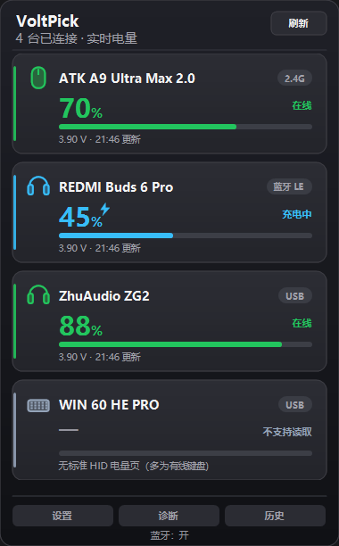
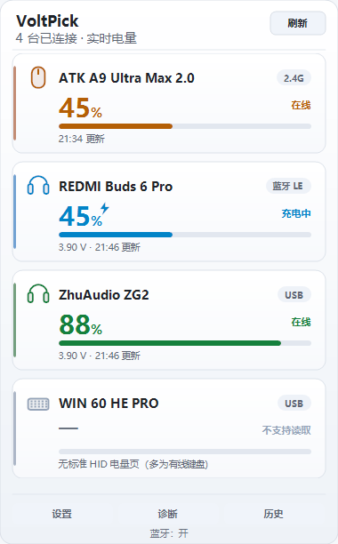
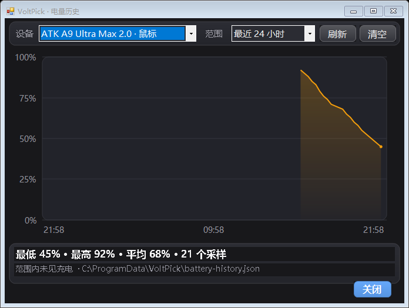
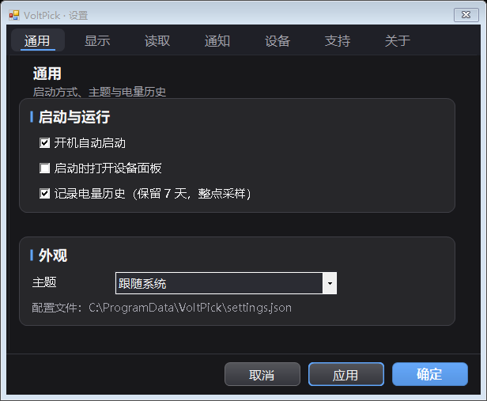
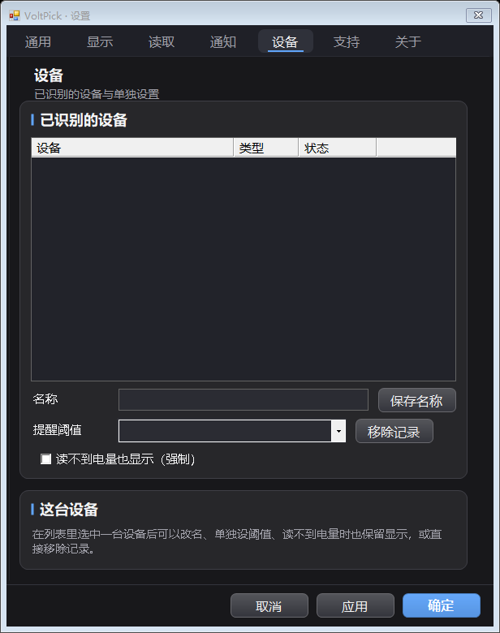
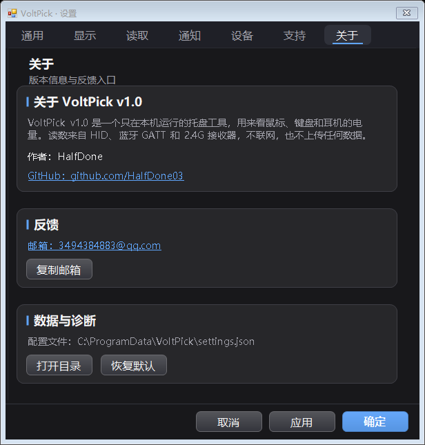
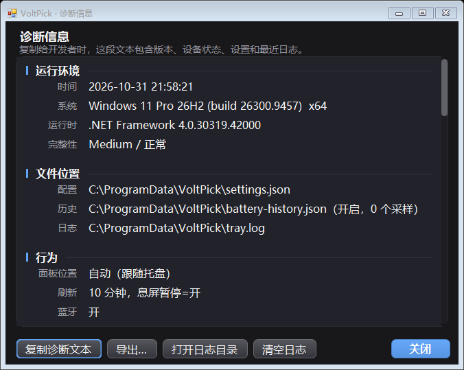

# VoltPick

**VoltPick** is a Windows system-tray utility that shows the battery level of your mouse, keyboard and headset right in the taskbar. Single exe, read-only, no network access, no admin rights needed.

Every reading comes from the device's own battery interface: standard HID for mice and keyboards, the standard Battery Service over Bluetooth, HID++ 2.0 for Logitech wireless gear, and vendor-private protocols for some 2.4G receivers. Devices that cannot be read say why - VoltPick never shows a guess.

Version **v1.0**.

> 以下为中文使用说明（The Chinese manual starts below）。







## 快速开始

1. 双击 `VoltPick.exe`。
2. 托盘出现数字图标；左键打开面板，右键打开菜单。
3. Windows 11 若没有图标：任务栏设置 → 其他系统托盘图标 → 打开「VoltPick」。

## 功能

* **托盘图标**：默认合并成一个图标显示最低电量设备，也可每台设备一个图标；可固定显示鼠标/键盘/耳机，或指定某台设备。断连会自动回退。
* **鼠标悬停看全部**：把鼠标停在托盘图标上就能看到各设备电量，不用打开面板。系统对提示文字有 63 字符上限，所以按「电量最低优先」排序，超出的设备用「另 N 台」概括——最该关注的那台一定看得见。
* **设备面板**：左键托盘打开，显示已连接设备的电量、状态和更新时间。设备多时最多 4 张卡片，右侧出现滚动条。
* **电量历史**：保留最近 7 天的本地采样，可查看 24 小时/7 天趋势图；鼠标悬停在曲线上可查看该时刻的具体电量。数据存在配置目录，不联网。
* **低电提醒**：全局 20% / 15% / 10% / 5% 各提醒一次；也可在设置 → 设备给单台设备单独设置阈值，可选「关闭 / 5% / 10% / 15% / 20% / 25% / 30%」。支持免打扰时段和全屏抑制。
* **托盘图标样式**：图标不再画底色块，只有数字（铺满 16×16 托盘位置）；「图标颜色」直接就是数字颜色，笔画实心、不加描边（描边在 16px 下会把字糊成一团）；数字按长方形比例铺满整个槽位，横向最多拉伸 1.3 倍。数字大小分「不显示数字（留点）/ 较小 / 标准 / 较大」四档（选「不显示数字」时只留一个小圆点，免得托盘上完全看不见、点不到），样式分「柔和（细窄）/ 经典（高大）/ 圆润（扁矮）」三种。数字字体可在设置里单独选（跟随样式 / 粗黑 / 半粗 / 常规加粗 / 雅黑加粗 / Verdana / Tahoma / Arial Black / Bahnschrift / Impact，默认「跟随样式」，缺字体时自动退回 Segoe UI，不会画成空白图标）。
* **主题**：跟随系统 / 浅色 / 深色，作用于面板、设置和历史窗口。





## 作者与问题反馈

**HalfDone** · 邮箱：3494384883@qq.com · GitHub：<https://github.com/HalfDone03/VoltPick>





遇到问题或发现 bug，可以按下面的方式反馈：

1. 左键托盘打开面板，点右上角的「诊断」，在诊断视图里点「复制诊断文本」。
2. 把复制到的内容粘进邮件，按里面的模板补上复现步骤：
   - 你做了什么（操作步骤）
   - 实际看到什么（现象或报错）
   - 你期望是什么
   - 能否稳定复现
   - 涉及哪台设备、什么连接方式
3. 需要的话再附上日志文件：在同一个诊断视图里点「打开日志目录」，日志默认在 `%LOCALAPPDATA%\VoltPick\logs\tray.log`。

反馈内容里已经自动带上了版本、系统、蓝牙状态和每台设备的读数状态，省得来回问。写邮件直接点 设置 → 关于 里的邮箱地址就行。

## 目录结构

```text
电量监测/
├─ VoltPick.exe          开发版成品，双击即用
├─ README.md             本文件（程序启动时按 exe 同目录读取）
├─ AGENTS.md             本项目的开发约定
└─ 开发/                 全部源码与工具
   ├─ src/               源码（C# 5，.NET Framework 4.8）
   ├─ tools/             测试与图标工具源码
   ├─ tests/             真机布局核对脚本（db-live_LiveLayout.cs）
   ├─ lib/winmd/         编译所需的 WinRT 引用
   ├─ assets/            图标 app.ico、源图 icon-source.jpg、截图
   ├─ build.ps1          重新编译 exe（输出到上一层目录）
   └─ test.ps1           重建 exe 并跑全部自测（305 条断言 + 3 个冒烟程序）
```

开发时改 `开发/`，`build.ps1` 把 exe 输出到最外层（也就是本文件旁边）。不做打包发布，只保留一个 exe。

## 构建与测试

在 `开发/` 目录里执行：

```powershell
powershell -ExecutionPolicy Bypass -File .\build.ps1
powershell -ExecutionPolicy Bypass -File .\test.ps1
```

`build.ps1` 会把 `VoltPick.exe` 输出到上一层目录，不会在 `开发/` 里留生成物。

不需要安装 SDK，使用 Windows 自带的 .NET Framework 4.8 `csc.exe`。WinRT 引用在 `lib/winmd/`。

`test.ps1` 会先重建 exe，再依次跑 305 条断言和 3 个冒烟程序（托盘、历史、面板滚动）。断言条数由 `TestHarness` 里的 `ExpectedChecks` 核对，少跑一条也算失败；任何一步失败都会以非 0 退出。临时 exe 都写在 `tests/` 下，结束时统一删除。

`app.ico` 由 `assets/icon-source.jpg` 生成十档尺寸（16/20/24/32/40/48/64/96/128/256）：线性光下逐级 2×2 减半 → 带预滤波的 Catmull-Rom 重采样 → 双边保边平滑 → 5×5 二项式掩膜锐化 → 4×4 超采样圆角，小尺寸另走注意力裁切与去噪；换图标时改源图，再手动跑一次 `tools/MakeIcon.cs`（不参与 build/test，命令行写在文件头注释里）。

**更新迭代约定**：正在运行的 `VoltPick.exe` 会锁住输出文件导致 `error CS0016`。重新构建前直接结束该进程即可（用户已明确授权，不需要先询问）：

```powershell
Get-Process -Name 'VoltPick' -ErrorAction SilentlyContinue | ForEach-Object { $_.Kill() }
```

改完记得重新启动程序，并用 `--once` 加托盘日志确认新版本工作正常。

## 支持范围

### 已经能读到电量的品牌与通道

| 品牌 / 通道 | 覆盖设备 | 实现方式 |
| --- | --- | --- |
| **罗技 Logitech** | Lightspeed / Unifying / Bolt 接收器后面的无线鼠标、键盘、耳机 | HID++ 2.0，Feature `0x1000` BATTERY_STATUS |
| **雷蛇 Razer** | 无线鼠标、键盘、BlackShark 耳机 | 90 字节 HID 特征报文（同 Synapse / OpenRazer），命令类 `0x07` 的 `0x80` 电量 / `0x84` 充电 |
| **赛睿 SteelSeries** | Arctis Nova / Arctis 7+ / GameBuds 耳机，Rival 3 / Aerox 3·5·9 无线鼠标 | `0xFFC0` 配置集合：耳机 `B0` 交换、鼠标 `AA` / `D2` 交换 |
| **WLmouse / Lamzu / G-Wolves** | Beast X 系列、Maya X、G-Wolves 无线鼠标 | `0x83` 查询（旧固件回退 `0x8F`），电压/电量帧逐字节校验 |
| **MCHOSE** | M7 / A7 / L7 / K7（0x5253）、A5 Pro Max（0x2023）、G7（0xA8A5） | 取反载荷的 `0x11` / `0x12` 特征报文，以及 `0x83`、`AA 30` 两种回包 |
| **Pulsar / VXE / Hitscan** | X2 系列、VXE R1 系列、Hyperlight | 17 字节 `08 04` 帧，校验 `85 - 前16字节之和` |
| **华硕 ROG / TUF** | Gladius III、Harpe Ace、Keris、Chakram、Spatha X、Strix Impact II 等无线鼠标 | 厂商集合上发 65 字节 `00 12 07`，回显 `12 07`，电量在 `+4`、充电在 `+9`；老型号档位 ×25 |
| **HyperX** | Cloud II Wireless（`0696` / `018B` 两种接收器） | 厂商集合 `FF90:0305` 上发 52 字节 `06 FF BB <命令>`，电量在 `[7]`、充电在 `[4]` |
| **JBL** | Quantum 910 Wireless | 耳机主动推送报告 `0x08`，电量在第 1 字节（无请求可发，也没有充电标志） |
| **ATK** | ATK 无线鼠标（如 A9 系列） | 厂商 HID，自动读鼠标本体型号 |
| **Airoha 方案** | 用该方案的部分 TWS 耳机（如部分 REDMI Buds） | 蓝牙 GATT 厂商服务 |
| **标准 HID 电池页** | 多数蓝牙键鼠、部分 2.4G 接收器（不限品牌） | HID 使用页 `0x06` 的 `0x20` StateOfCharge / `0x24` RelativeStateOfCharge，Feature 优先、Input 回退 |
| **蓝牙 LE 标准电量服务** | 提供 `0x180F` 的耳机、键鼠 | GATT `0x180F` / `0x2A19` |

### 暂不支持（未实现私有协议）

海盗船 Corsair（Void 系列与其 bragi 协议的无线鼠标）、Keychron 等厂商的私有 HID 协议，以及多数国产 2.4G 接收器（名字形如 `2.4G Receiver`、且不暴露标准电池页的设备），目前读不到电量。这些设备按「读不到就不显示」的规则不出现在面板，但记录保留在 「设置 → 设备」里。

想确认某台设备走的是哪条通道，打开设置 → 支持，或看日志里的「设备发现」一行；面板的「诊断信息」里也有每台设备的来源。

### 按设备类型

程序读取设备自己上报的电量，不绑定品牌。

| 设备类型 | 连接方式 | 电量 |
| --- | --- | --- |
| 鼠标 | 标准 HID 电量接口 | ✅ Feature 优先、Input 回退 |
| 鼠标 | 蓝牙 LE 标准电池服务 | ✅ |
| 鼠标 | 罗技接收器（Lightspeed / Unifying / Bolt） | ✅ HID++ 2.0 |
| 鼠标 | ATK 接收器 | ✅ 厂商 HID，可显示鼠标本体型号 |
| 鼠标 | 其它厂商私有 2.4G 接收器 | ⚠️ 未实现协议时读不到，按规则不显示 |
| 键盘 | 标准 HID 电量接口 | ✅ 不绑定 VID/PID 或品牌 |
| 键盘 | 蓝牙 LE | ✅ 含 HID over GATT 发现 |
| 键盘 | 罗技 HID++ 2.0 | ✅ 读设备名后自动归类为键盘 |
| 键盘 | 有线且无电量接口 | ⚠️ 自动忽略，记录保留 |
| 耳机 | 蓝牙 LE 标准电池服务 | ✅ 单总值；固件提供实例时显示 L/R/充电盒 |
| 耳机 | 蓝牙 LE 厂商私有服务 | ✅ 部分型号可读到左右耳分别的电量 |
| 耳机 | 罗技 HID++ 2.0 | ✅ G 系列无线耳机 |
| 耳机 | 其它 2.4G 接收器 | ❌ 通常只传音频和按键，不传电量；按「读不到就不显示」规则不出现在面板 |
| 耳机 | 经典蓝牙（仅 HFP） | ❌ 通道被 Windows 音频独占，程序不抢占音频 |

## 系统兼容性

目标是 Windows 10 与 Windows 11（x64），基于 .NET Framework 4.8。只有少数纯外观相关的 API 需要更高系统版本，缺失时自动降级，读取电量不受影响。

| 依赖 | 最低系统 | 缺失时的表现 |
| --- | --- | --- |
| `SetProcessDpiAwarenessContext` | Win10 1703 | 自动回退 `SetProcessDPIAware` |
| `DwmSetWindowAttribute`（属性 19/20） | Win10 1809 | 标题栏保持系统默认色，其余不受影响 |
| `DwmSetWindowAttribute`（属性 33，窗口圆角） | Win11 22000 | 退回 `Region` 裁剪，圆角有锯齿台阶 |
| 蓝牙 LE（WinRT） | Win10 1703+ 且有 BLE 适配器 | 蓝牙设备显示「蓝牙已关闭」或读取失败原因 |

几点说明：

* 所有平台相关调用都包在 `try/catch` 里，API 缺失只会降低外观效果，不会崩溃。
* **版本显示**：`Environment.OSVersion` 和 `GetVersionEx` 在 Windows 10/11 上都会返回 `6.2.9200` 这个兼容性伪装值，无法区分版本。程序改用注册表读取真实版本，诊断里会显示类似 `Windows 11 Pro 25H2 (build 26220.9739)`。
* Windows 11 的 `ProductName` 注册表值仍是 "Windows 10"，程序按 build ≥ 22000 自动纠正为 Windows 11。
* 深色标题栏在 Win10 1809–1909 上部分版本不生效，属于系统限制，不影响功能。

## 当前边界

* **不伪造读数**：读不到就不显示。托盘与面板只列出「当前连接且能真正读出电量」的设备，读不到电量的设备（有线键盘、2.4G 接收器耳机、经典蓝牙 HFP、耳机只读出充电盒等）不占卡片，但记录仍保留在「设置 → 设备」里，可以重命名、单独设低电阈值。永远不显示 0% 或估计值，也不做电压换算。历史曲线超过 2 小时的间隔画成断点，不插值。
* **大跳变需确认**：设备侧电量计可能在两个稳定状态之间切换（实测某 2.4G 鼠标在 40% 与 55% 之间来回，各自能维持数十分钟到数小时）。读数与上次确认值相差 ≥10 个百分点时先挂起，需连续两次读到同一新值才生效；挂起期间界面继续显示旧值，最多 2 分钟再确认一次，避免历史曲线被画成锯齿。
* **经典蓝牙 HFP**：Windows 音频占用 HFP 通道时无法并行读取，Classic 设备明确降级。
* **键盘电量**：标准 HID/蓝牙 LE 路径已实现，开发环境没有无线键盘样本，只验证了「无键盘时枚举不崩溃」和按设备名归类为键盘的逻辑，实际读数待真机验证。
* **Windows 11 托盘**：新图标可能被收进 `^`，需在系统设置里固定，程序无法可靠检测这一状态。
* **配置位置**：默认 `%APPDATA%\VoltPick\settings.json`；开启便携模式后改为 exe 同目录。
